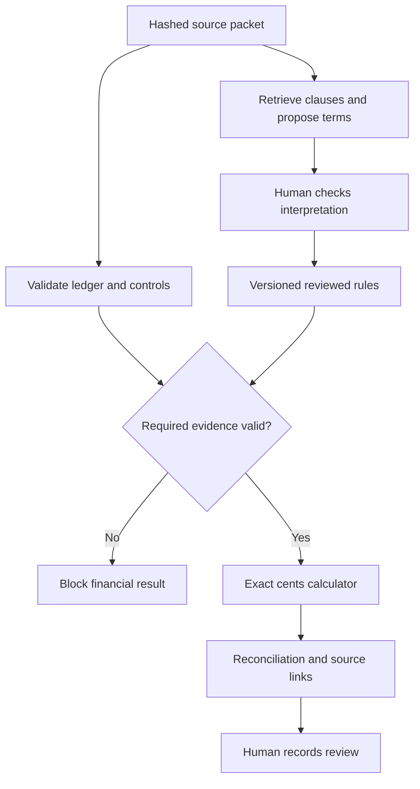

# BorrowCheck

**Mohit Kumar · Entry No. 2023EE10862 · Tresata Assignment**

I built BorrowCheck with AI assistance to answer one question: **does a borrower's receivables borrowing-base certificate follow the reviewed agreement?** It connects an exact calculation to the invoice rows, operative clauses, and review decisions behind it.

The worked example detects a **$96,000 overstatement**: the submitted certificate says $574,000; the supported base is **$478,000**. The subtle error is that missing a cross-age exclusion also inflates another debtor's concentration allowance.

The application runs locally with Python's standard library. It includes a review interface, an evidence viewer, JSON/CSV/HTML exports, ten synthetic packets, and an optional schema-constrained LLM extraction adapter. **It does not authorize funding.**

[Four-page brief (PDF)](docs/Tresata_Brief.pdf) · [Markdown brief](docs/Tresata_Brief.md)

## Run in one minute

From this repository's root, with Python 3.11 or newer:

```bash
python -m borrowcheck demo
python -m borrowcheck serve
```

Open **http://127.0.0.1:8765**. No API key, npm installation, database service, or Python package installation is required. On systems where Python is named `python3`, use that command instead.

In the review screen, inspect the $478,000 result, open its source clauses, switch to the missing-reserve packet, and run the ten acceptance cases. Review history records local demo events, not authenticated lender approvals.

```bash
python -m unittest discover -s tests -v
python -m borrowcheck evaluate
python tools/benchmark.py
```

**Verification:** 77 Python tests passed, including 120 randomized portfolios compared with an independent rational-arithmetic oracle. All ten acceptance packets passed. A local core-engine benchmark processed 100,000 invoices in a median **0.400 seconds** across three runs. This is not an end-to-end latency or production capacity claim. [Full results and limits](docs/EVALUATION.md).

## How it works



I separate language interpretation from financial computation. Optional AI proposes four parameters with exact quotes. It cannot install rules, calculate money, or approve funding. Unchanged ledger runs make **zero LLM calls**. A valid citation is evidence of origin, not proof that its interpretation is correct.

The deterministic engine applies allocated credits, ageing, debtor-wide cross-ageing, full-invoice disputes, concentration, the advance rate, reserves, and the commitment in a defined order. Monetary values are integer cents; rates are integer basis points. Runtime is **O(n + d)** for `n` invoices and `d` debtors, with O(n + d) memory for the evidence-rich result.

[Architecture and trade-offs](docs/ARCHITECTURE.md) · [Packet format](docs/DATA_FORMAT.md) · [Security boundary](SECURITY.md)

## Inspect the outputs

```bash
python -m borrowcheck demo --case 04_worked --out outputs/worked
python -m borrowcheck run examples/08_amendment/packet.json --out outputs/amended
python -m borrowcheck demo --case 09_missing_reserve --out outputs/blocked
```

Each run exports `reconciliation.json`, `invoices.csv`, and `evidence.html`. The missing-reserve command intentionally exits with code 2 and a null base. `READY_FOR_REVIEW` means the configured checks passed, not that a lender approved the result.

## Try rule extraction

The offline path is a **narrow synthetic-template parser**, not a disguised LLM:

```bash
python -m borrowcheck extract examples/04_worked/packet.json --out outputs/proposal.json
```

For a live model, set `OPENROUTER_API_KEY` and `OPENROUTER_MODEL` in your shell, then explicitly permit sending the selected public/synthetic documents:

```bash
python -m borrowcheck extract examples/04_worked/packet.json --provider openrouter --allow-network --out outputs/model-proposal.json
```

Choose a model that supports strict JSON-schema output. There is no paid default. The adapter allows one validation repair, saves successful-call prompt/response logs in proposal metadata, and returns an unapproved proposal. `.env` files are not loaded automatically. Do not commit API keys or private documents.

After actually comparing **every proposed value, operator, denominator, exception, and date** against the complete source packet:

```bash
python -m borrowcheck approve-proposal examples/04_worked/packet.json outputs/proposal.json --reviewer "Mohit Kumar" --attest-reviewed --out examples/04_worked/reviewed.json
python -m borrowcheck run examples/04_worked/reviewed.json --out outputs/reviewed
```

This records a local demonstration review and preserves the original packet. It provides no identity authentication. Live LLM accuracy, latency, and cost have **not** been measured; adapter tests use clearly labelled mock responses.

## Project guide

| Location | Purpose |
|---|---|
| `borrowcheck/engine.py`, `money.py` | Pure reconciliation and exact money |
| `packets.py`, `evidence.py` | Validation, effective versions, hashes and source coordinates |
| `extraction.py` | Retrieval, local parser, optional LLM proposals and human review |
| `audit.py`, `web.py`, `static/` | Local review workflow and hash-linked event log |
| `examples/` | Ten fully synthetic document/ledger packets and independent expected outcomes |
| `tests/` | Unit, boundary, adversarial, API, audit and workflow tests |
| `tools/` | Reproducible fixture generator, benchmark and optional browser smoke checks |
| `docs/` | Four-page brief, architecture, evaluation and AI-use disclosure |

The Python runtime has no third-party dependencies. Optional PDF text extraction needs Poppler's `pdftotext`; scans require manual transcription because OCR is not implemented. Optional browser verification uses the pinned Playwright development dependency in `package.json`; see [evaluation](docs/EVALUATION.md).

## Scope and provenance

My initial scope is a US, USD, domestic commercial receivables facility under New York law. Synthetic terms are deliberately limited and are **not legal defaults**. Inventory, FX, legal opinions, underwriting, fraud certification, general contract interpretation, and payment execution are outside scope.

The [OCC Asset-Based Lending handbook](https://www.occ.treas.gov/publications-and-resources/publications/comptrollers-handbook/files/asset-based-lending/pub-ch-asset-based-lending.pdf) and a [historical L.A.R.K./Bank of America agreement](https://www.sec.gov/Archives/edgar/data/1723866/000095012318006397/filename10.htm) informed the problem exploration. This repository contains invented records, not that borrower's data or a copy of its agreement. The business time/cost estimates in the brief are assumptions, not measured savings.

I describe AI assistance and my own contribution in [What I Added Beyond the AI](docs/AI_USAGE.md). The software is released under the [MIT License](LICENSE).
