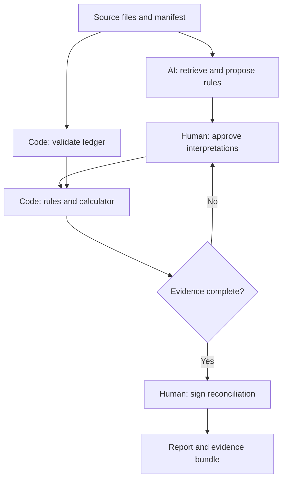

# Borrowing-Base Reconciliation with Verifiable Evidence

**Mohit Kumar | Entry No. 2023EE10862 | Tresata Assignment**

## Problem, evidence, and economic case

**The problem.** I propose a reconciliation tool for collateral analysts at US asset-based lenders who verify whether a borrower's monthly receivables borrowing-base certificate follows the operative loan agreement. The analyst reconciles the receivables ledger, ageing report, credit notes, amendments, and lender notices, then explains discrepancies to an approving credit officer. My proposed tool produces a reviewable reconciliation; it does not authorize lending.

**Frequency and urgency.** Reporting is recurring and can intensify when liquidity weakens. A public L.A.R.K. Industries/Bank of America agreement requires monthly certificates and switches to weekly reporting when specified availability conditions are met. That makes the immediate business trigger concrete: more verification work when mistakes are particularly costly.[2]

**What exploration revealed.** The OCC describes manual collateral monitoring as time-intensive and vulnerable to error and fraud.[1] What surprised me in the AI-assisted source review was that eligibility is not just an invoice-age filter. The reviewed agreement includes debtor-wide cross-ageing, concentration limits with named exceptions, partial exclusions for some offsets, and lender discretion.[2] My design therefore addresses a central risk: a correct calculation can still be wrong if it uses an incomplete contract package or an unapproved interpretation. A citation proves where text came from, not that every relevant exception was found.

**Illustrative current cost, not an industry benchmark.** I assume 50 borrowers, 12 certificates annually, two analyst hours plus 30 minutes of approval per certificate, and $75/hour blended loaded cost. The baseline is **1,500 hours and $112,500 annually**. Reducing review to 45 minutes would release 1,050 hours, worth $78,750 before implementation, model, integration, and maintenance costs. I would validate these assumptions through timed practitioner reviews. Financial risk includes excess lending against ineligible collateral; operational risk includes delayed borrower liquidity and weak audit evidence. I do not estimate expected losses without loss-frequency data.

**Why AI, and why this boundary now.** I propose using AI to turn changing, differently worded documents into structured rule candidates while leaving established calculations in ordinary software. A fixed spreadsheet can calculate a stable facility perfectly; regex templates become expensive when definitions, exceptions, and amendments move or change wording. I would retain AI only if it lowers this interpretation and maintenance burden. Routine ledger processing requires no LLM. If manually configured rules perform equally well at lower total cost, I would choose that simpler solution.

**Scope.** I would start with one US commercial borrower, USD domestic trade receivables, and a New York-law facility, verifying a receivables-only borrowing base at a specified reporting date. I exclude inventory, foreign-currency conversion, underwriting, fraud certification, lien-perfection opinions, default declarations, and payment execution. Legal eligibility conditions require approved evidence or human attestation; my design never infers them from an invoice alone. For another jurisdiction, local counsel must reassess assignment, security/enforcement, privacy, and reporting requirements; the calculation framework is reusable, the rule pack is not automatically portable.

**Rejected alternatives.** I ruled out a single LLM that reads and calculates because it cannot guarantee arithmetic or complete evidence. A generic RAG chatbot cannot enforce reconciliation invariants. A universal rules engine ignores negotiated variation, although I would benchmark against a facility-specific spreadsheet. Multiple debating agents add latency and correlated opinions without establishing legal authority. My proposed compromise is human-approved extraction with conventional computation.

**Research sources.** [1] [OCC, Asset-Based Lending, v1.1, printed pp. 22-23, 28 and 71](https://www.occ.treas.gov/publications-and-resources/publications/comptrollers-handbook/files/asset-based-lending/pub-ch-asset-based-lending.pdf), including its 2025 update note. [2] [L.A.R.K./Bank of America, Loan and Security Agreement, 3 September 2014](https://www.sec.gov/Archives/edgar/data/1723866/000095012318006397/filename10.htm), section 1.1, section 11.14 and Exhibit E. This historical exhibit illustrates contractual variation; it is not a current rulebook.

## Architecture and exact calculation

**Inputs and intake.** My design requires the executed agreement, operative amendments/waivers, lender notices, certificate, invoice CSV, credits, debtor IDs, control totals, reporting date, commitment, and reserve confirmation. A human authenticates the document manifest. The system hashes originals and validates duplicates, dates, currency, and totals. Unknown required data blocks release.

**Routing and orchestration.** My prototype parses native text, preserving PDF word coordinates. It uses BM25/TF-IDF retrieval and numbered-reference expansion, then includes complete small documents in a schema-constrained LLM request. It allows one validation repair; larger contexts block rather than truncate. Human-reviewed rules are reused, so unchanged CSV runs need no LLM. The offline demo uses a narrow template parser, not an LLM. Verified OCR and semantic embeddings remain production extensions.

**Two separated layers.** Extraction/interpretation is probabilistic. A collateral specialist approves each rule's operator, threshold, denominator, ordering, exception, and effective date; counsel resolves ambiguity. Only reviewed rules enter the deterministic engine: allowlisted predicates, integer-cent arithmetic, contractual rounding, no model-generated executable code. The credit officer owns final approval. Local review hashes demonstrate integrity checks; production requires authenticated signatures.

**Knowledge and updates.** I would store evidence in immutable documents and approved rules in versioned SQL records, including debtor mappings, effective/expiry dates, and when rules became known. The retrieval index is a rebuildable aid. Amendments/notices invalidate affected approvals and require a semantic diff, regression tests, and a new version. Late-discovered changes trigger review of affected reports while preserving historical replay. Missing reserve confirmation is not a zero reserve.

**Exact synthetic example.** My demonstration terms exclude invoices older than 90 days; cross-age debtors when at least 50% of their net balance is overdue; then cap each debtor at 20% of the pre-concentration pool. Credits are allocated first. The calculation advances 80%, subtracts a confirmed $50,000 reserve, floors at zero, and caps at a $1 million commitment. These invented terms are not legal defaults or source [2]'s terms.

For remaining debtor balances `E_d`, let `S = sum(E_d)`. Then `E = sum(min(E_d, 0.20 × S))` and `B = min(commitment, max(0, 0.80 × E − reserve))`. The denominator is fixed before concentration deductions; no iterative recapping occurs. I floor each debtor cap and the aggregate advance to cents.

Gross receivables are $1 million. Debtor A has $100,000 overdue and $100,000 current: both are excluded by cross-ageing. Debtor B owes $300,000; five others owe $100,000 each. Thus `S = $800,000`; B's cap is $160,000; `E = $660,000`; and **the borrowing base is $478,000**. Excluding only A's overdue invoice produces $574,000, overstating the base by **$96,000**. Overlapping exclusion reasons are retained, but each dollar is removed once.

**Outputs and traceability.** My prototype returns `READY_FOR_REVIEW` or `BLOCKED`, with amounts, variance, exclusions, rule versions, and issues; blocked bases are null. Each calculation links to hashed CSV records/columns and reviewed rules, then document hashes, exact quotes, text offsets/lines or PDF page/word boxes. JSON, CSV and HTML exports support replay. Optional model calls retain prompt/response metadata. A separate local signoff records reviewer, rationale and result hash; it neither authenticates the lender nor authorizes funding.

## Risks, prototype blueprint, and decision gates

**Weakest point: incomplete authority.** I consider a missing amendment or discretionary notice the greatest weakness: it can invalidate an otherwise correct result. My design requires a human-approved operative-document manifest and reserve confirmation; retrieval cannot recover undisclosed documents. Cited-span checks and human rule approval address hallucinations, but even a valid quote can be misinterpreted. Effective-date/expiry checks prevent stale-rule use; debtor merges require approved legal IDs.

**Privacy and liability.** I use only public/synthetic data for this assignment. My production design requires tenant isolation, encryption, scoped access, retention controls, and a contractual no-training endpoint. Document instructions remain untrusted data; the model cannot install rules or call payment tools. The lender's credit officer owns approval; qualified counsel resolves legal ambiguity. My design preserves borrower certification and field audits: matching documents cannot establish invoice authenticity.[1]

**Implemented prototype.** I built BorrowCheck with AI assistance: a Python CLI, local review screen, clause proposals, exact reconciliation, SQLite audit chain, and evidence exports. It needs no third-party Python runtime package. Ten synthetic document/ledger packets include an amendment, reserve notice and eight-invoice worked case. The O(n + d) engine processed 100,000 invoices in a median 0.400 seconds over three local runs, excluding ingestion, model and UI time. Source [2] informed research; no private borrower data is included.

**Ten-example acceptance suite.** Each packet includes source documents, a ledger, reviewed synthetic rules, and explicit expected outcomes. All ten passed. The following values are synthetic.

| # | Example | Required outcome |
|---|---|---|
| 1 | Five current debtors, $200,000 each | Base = **$750,000**, using baseline terms. |
| 2 | Age boundary: 90 versus 91 days | Day 90 passes; day 91 fails; base **$350,000**. |
| 3 | Debtor 49% versus 50% overdue | At 50%, exclude the whole debtor; base **$390,800**. |
| 4 | Worked pack; certificate says $574,000 | Base **$478,000**; reported-minus-computed variance **+$96,000**. |
| 5 | Invoice overdue, disputed, cross-aged | One monetary deduction; retain every reason. |
| 6 | $100,000 invoice; allocated $15,000 credit | Invoice net **$85,000**; packet base **$328,400**. |
| 7 | Debtor aliases, $150,000 each | Missing legal IDs block; no guessed identity merge. |
| 8 | Cap 20% to 25%, effective 1 November | Worked ledger, no age crossings: 31 October **$478,000**; 1 November **$510,000**. |
| 9 | Missing reserve confirmation | `BLOCKED`; final base is null. |
| 10 | Document instruction to ignore all caps | `BLOCKED`; seeded hostile instruction quarantined. |

**Honest failure analysis.** All 77 Python tests passed, including 120 randomized portfolios against an independent rational-arithmetic oracle. One adversarial test shows a real 80% quote paired with an incorrect 81% proposal passes structural validation: human semantic review remains essential. Live LLM quality, OCR and practitioner savings are unmeasured. Browser rendering could not be verified because Chromium was unavailable. Undisclosed waivers and consistent fabricated ledgers can still escape the workflow.

**README and investment gate.** My repository documents setup, architecture, provenance, commands, optional model/prompt versions, fixtures, evaluation, security and license. Run `python -m borrowcheck serve` or `python -m unittest discover -s tests`. Before a pilot, I would obtain three analyst walkthroughs and 30 independently labelled packets, comparing against a spreadsheet. Require cent-exact results, complete evidence and seeded-blocker detection; measure false-ready cases, abstentions, cost and review time. The 45-minute review target remains a hypothesis.

## Appendix — What I Added Beyond the AI

### 1. Where AI Helped Me

I used AI for problem selection, public-source research, architecture, synthetic examples, implementation, debugging, test design, and drafting. With its help, I narrowed the task to reconciling a receivables borrowing base with auditable evidence.

Three key excerpts from my prompt were:

1. “Pick a high-friction, document-heavy niche area of finance.”
2. “Separation of deterministic vs. probabilistic layers (e.g., exact financial math/cited clauses vs. probabilistic extraction).”
3. “Weakest points of the design and what breaks them.”

My cost model, demonstration contract, architecture, and acceptance targets are proposals, not observed facts. The drafting/development conversation records this assistance; successful optional model calls also save prompt/response metadata. No live model evaluation was performed.

### 2. What I Rejected or Corrected

I reviewed the following decisions and corrections with AI assistance. They are not claims of independent practitioner experience.

- **A universal ageing/concentration rule.** Source [2] contains its own thresholds and named exceptions. I therefore label every invented term and require approval of a facility-specific rule pack.
- **Treating quoted text as sufficient assurance.** A real clause may be superseded or qualified elsewhere. I include cross-reference resolution, document completeness checks, and effective-date approval alongside citations.
- **Trusting stored evidence without rechecking.** During implementation, control values and stored coordinates could diverge from their citations. Checks now bind controls to cited USD amounts and rederive line/PDF coordinates; regression tests cover both.
- **Reporting unperformed tests as evidence.** I report 77 passing Python tests and ten acceptance outcomes separately from unmeasured live-model quality, OCR and review savings. The browser download failure is disclosed rather than counted as a visual test pass.

### 3. What Came From Me

My independent contribution was the design brief and its evaluation criteria: one specific problem, deterministic financial outputs, exact source traceability, explicit jurisdictional limits, human accountability, and realistic edge cases. These requirements guided the scope and evaluation of the proposal.

AI helped develop the borrowing-base niche, cross-ageing example, architecture, code and tests. My original input was the design requirements, not prior practitioner research or an independently built implementation. The prototype demonstrates the design; independent domain and operational validation is still required.

### 4. One Thing I'd Stand Behind Without AI

I would defend the deterministic reconciliation and its assumptions. In the worked example, a 50% overdue share excludes all $200,000 owed by debtor A. The remaining pool is $800,000. A 20% concentration limit admits $160,000 of debtor B's $300,000, leaving $660,000 eligible. Advancing 80% and subtracting the $50,000 reserve produces $478,000.

The apparent $100,000 omission creates a $96,000 overstatement because it also inflates the concentration allowance by $20,000: `80% × ($100,000 + $20,000) = $96,000`. This explains why exclusion order and denominator definitions must be explicit. The calculation can be exact while its assumptions remain wrong; approved evidence and accountable review are therefore part of the calculation's validity.
